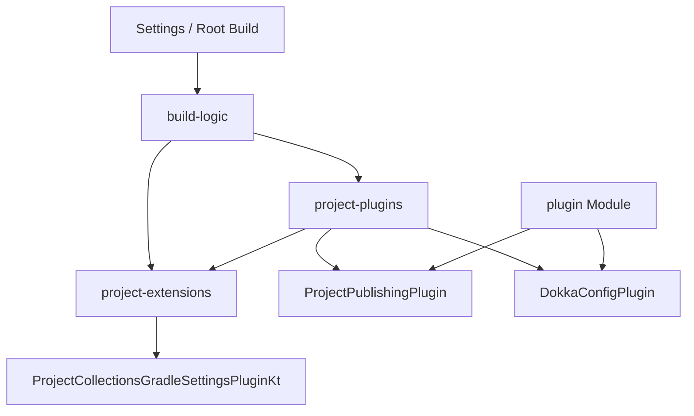

# Requirements

### Overview & Goals
The objective of this initiative is to optimize build performance, eliminate redundant daemon processes, and modernize Gradle build architecture by:
1. Converting script-based precompiled plugins (`publishing.gradle.kts` and `dokka-config.gradle.kts`) into pure Kotlin Gradle plugin classes (`ProjectPublishingPlugin` and `DokkaConfigPlugin`).
2. Eliminating dependencies on `kotlin-dsl` / `gradleKotlinDsl()` across `build-logic` to prevent the spawning of mismatched secondary Kotlin Compiler Daemons.
3. Decoupling plugin logic and extension utilities from cross-project state (`rootProject`) to achieve full compatibility with Gradle Isolated Projects.
4. Centralizing all versions in the Version Catalog (`gradle/libs.versions.toml`) so each dependency is managed in a single location.
5. Applying Gradle best practices to improve build reliability, security, and maintainability.

### Scope
- **In Scope:**
  - `build-logic/project-extensions`: Refactor extensions to remove `gradleKotlinDsl()` imports and replace `rootProject` accesses with isolation-safe APIs.
  - `build-logic/project-plugins`: Implement `ProjectPublishingPlugin.kt` and `DokkaConfigPluginNew.kt`, delete `.gradle.kts` script plugins, and remove `gradleKotlinDsl()` dependency.
  - `plugin/build.gradle.kts`: Clean up legacy configurations (such as empty `afterEvaluate`), optimize task wirings, and ensure isolated project compliance.
  - `gradle/libs.versions.toml`: Add missing version entries (e.g., `kotlin-test`) and ensure all hardcoded versions are migrated to the catalog.
  - `gradle.properties`: Add missing performance and security properties (`org.gradle.jvmargs` with UTF-8 encoding, wrapper checksum).
  - `gradle/wrapper/gradle-wrapper.properties`: Switch from `-all.zip` to `-bin.zip` distribution and add `distributionSha256Sum`.
  - Verification of configuration cache and isolated projects execution.
- **Out of Scope:**
  - Altering functional logic of `ProjectCollectionsGradleSettingsPlugin` runtime behavior.
  - Migrating to GitHub Actions CI (documented as a follow-up recommendation).

### User Stories
- **As a Developer**, I want build-logic compiled as standard JVM plugins without `kotlin-dsl` so that my build uses a single unified Kotlin Compiler Daemon, minimizing memory consumption and configuration time.
- **As a Maintainer**, I want all convention plugins and project extensions to avoid cross-project model access so that the build is fully compatible with Gradle Isolated Projects and Configuration Cache.
- **As a Release Manager**, I want all versions declared in a single file (`libs.versions.toml`) so that updating a dependency requires editing only one location.
- **As a Security-Conscious Developer**, I want the Gradle wrapper distribution verified via SHA-256 checksum to ensure supply chain integrity.

### Functional Requirements
- `ProjectPublishingPlugin` must configure the `java-gradle-plugin`, `com.gradle.plugin-publish`, `maven-publish`, and `signing` plugins with identical coordinates, POM metadata, and repository credentials as previously declared.
- `DokkaConfigPlugin` must configure Dokka v2 extension properties, source sets, documentation links, versioning plugins, and documentation sync/packaging tasks identically to the script plugin.
- Extension helper functions in `project-extensions` must operate solely on the receiving project context and `layout.settingsDirectory` without navigating `rootProject`.
- All version strings (Kotlin, JDK, Dokka, Gradle Plugin Publish, project version) must be sourced from `libs.versions.toml` via `libs.versions.*` accessors.
- The build must execute successfully with `--configuration-cache` and Isolated Projects checks enabled.

### Non-Functional Requirements
- **Resource Optimization**: Eliminate unnecessary daemon processes to maximize developer machine throughput and CI resource efficiency.
- **Maintainability**: Provide statically compiled, refactor-friendly Kotlin plugin classes with explicit API bindings.
- **Future Compatibility**: Adhere strictly to Gradle 8.x/9.x isolation contracts.
- **Security**: Verify Gradle wrapper distribution integrity via SHA-256 checksum.
- **Best Practices Compliance**: Address all High and Medium severity Gradle best practice violations identified in the audit.

# Technical Design

### Gradle Best Practices Audit
The following violations were identified during investigation of the project files. These will be addressed as part of the migration.

#### High Severity

**Do not call `get()` on a Provider outside a Task action** — `publishing.gradle.kts:43-44`
- **Where:** `publishing.gradle.kts` lines 43-44: `providers.environmentVariable("GITHUB_ACTOR").get()` and `.get()` for `GITHUB_TOKEN`.
- **Issue:** Calling `.get()` during configuration phase fails if the environment variable is absent (local development). The value should be resolved lazily.
- **Fix:** Use `providers.environmentVariable("GITHUB_ACTOR")` directly in `credentials { username = ... }` — the `maven-publish` plugin accepts `Provider<String>` for credentials. If not supported, resolve inside a task action.
- **Reference:** https://docs.gradle.org/current/userguide/best_practices_tasks.html#avoid_provider_get_outside_task_action

**Avoid `afterEvaluate`** — `plugin/build.gradle.kts:73-75`
- **Where:** `plugin/build.gradle.kts` lines 73-75: empty `afterEvaluate { }` block.
- **Issue:** `afterEvaluate` bypasses lazy configuration and breaks configuration cache semantics. The block is empty and serves no purpose.
- **Fix:** Remove the empty `afterEvaluate { }` block entirely.
- **Reference:** https://docs.gradle.org/current/userguide/best_practices_general.html#avoid_after_evaluate

#### Medium Severity

**Use the plugins block** — `settings.gradle.kts:12-13`
- **Where:** `settings.gradle.kts` lines 12-13 declare plugin versions inline; `build-logic/settings.gradle.kts:3` also hardcodes Kotlin version.
- **Issue:** Plugin versions are duplicated in settings files instead of being managed via the version catalog.
- **Fix:** Reference versions from `libs.versions.toml` or use `libs.plugins.*.get().version` where the catalog is available. For `build-logic`, the settings file references the parent catalog via `dependencyResolutionManagement`, so plugin versions can be sourced from there.
- **Reference:** https://docs.gradle.org/current/userguide/best_practices_general.html#apply_plugins_using_the_plugins_block

**Don't hardcode Task names** — `plugin/build.gradle.kts:103-106`, `112-114`
- **Where:** `plugin/build.gradle.kts` lines 103-106: `named<Task>("check")`; lines 112-114: `named<Test>("functionalTest")`.
- **Issue:** String literal task names are used instead of task providers or public constants.
- **Fix:** Use `tasks.named("check")` without casting to `Task` where type-specific configuration isn't needed. For `functionalTest`, the provider returned by `testing.suites.register` already provides a `testTask` property — use that directly.
- **Reference:** https://docs.gradle.org/current/userguide/best_practices_tasks.html#dont_hardcode_task_names

**Validate the Gradle Distribution SHA-256 Checksum** — `gradle/wrapper/gradle-wrapper.properties`
- **Where:** No `distributionSha256Sum` property in the wrapper properties file.
- **Issue:** Without a checksum, a tampered or corrupted Gradle distribution could be executed.
- **Fix:** Add `distributionSha256Sum` for Gradle 9.8.2 (the published SHA-256 of `gradle-9.8.2-all.zip` or `-bin.zip`).
- **Reference:** https://docs.gradle.org/current/userguide/best_practices_security.html#validate_gradle_checksum

**Use UTF-8 File Encoding** — `gradle.properties`
- **Where:** `gradle.properties` has no `org.gradle.jvmargs` property.
- **Issue:** Without explicit UTF-8 encoding, builds may behave differently on systems with different default encodings.
- **Fix:** Add `org.gradle.jvmargs=-Dfile.encoding=UTF-8` to `gradle.properties`.
- **Reference:** https://docs.gradle.org/current/userguide/best_practices_performance.html#use_utf8_encoding

**Build Output Should Be Byte-for-Byte Reproducible** — `plugin/build.gradle.kts`
- **Where:** The build produces JAR artifacts (`dokkaHtmlJar`, `dokkaJavadocJar`, publications).
- **Issue:** No explicit reproducibility settings. Gradle 9 defaults are correct, but the build should be verified.
- **Fix:** Ensure `withType<AbstractArchiveTask>` sets `isPreserveFileTimestamps = false` and `isReproducibleFileOrder = true` if not already the default in Gradle 9.
- **Reference:** https://docs.gradle.org/current/userguide/best_practices_security.html#builds_should_be_reproducible

**Build your Published Artifacts Securely** — Standing advice
- **Where:** The build publishes artifacts via `maven-publish` and `com.gradle.plugin-publish`.
- **Issue:** Advisory: publishing should occur from a clean, isolated environment.
- **Fix:** Document that CI pipelines should disable build cache (`--no-build-cache`) and clear prior outputs before publishing.
- **Reference:** https://docs.gradle.org/current/userguide/best_practices_security.html#build-published-artifacts-securely

#### Recommendation Severity

**Prefer the `-bin` Gradle Distribution** — `gradle/wrapper/gradle-wrapper.properties:3`
- **Where:** `distributionUrl` ends with `-all.zip`.
- **Issue:** The `-all` distribution includes sources and documentation, increasing download size and extraction time unnecessarily for builds.
- **Fix:** Switch to `-bin.zip` distribution. Update `distributionSha256Sum` accordingly.
- **Reference:** https://docs.gradle.org/current/userguide/best_practices_performance.html#prefer_bin_distribution

**Use Version Catalogs** — `settings.gradle.kts:12-13`, `build-logic/settings.gradle.kts:3`
- **Where:** Plugin versions are hardcoded in settings files (e.g., `version("2.4.21")`).
- **Issue:** Versions are not centralized in `libs.versions.toml`, violating the single-source-of-truth principle.
- **Fix:** Move plugin version declarations to `libs.versions.toml` and reference them in settings. For `build-logic` settings, the catalog is already imported via `dependencyResolutionManagement`, so versions can be read from `libs.versions.kotlin.get()`.
- **Reference:** https://docs.gradle.org/current/userguide/best_practices_dependencies.html#use_version_catalogs

### Current Implementation
- `build-logic` consists of two subprojects: `:project-extensions` and `:project-plugins`.
- `build-logic/project-extensions` depends on `gradleKotlinDsl()`, using `embeddedKotlinVersion` and `org.gradle.kotlin.dsl.getByType`.
- `build-logic/project-plugins` contains script plugins `publishing.gradle.kts` and `dokka/dokka-config.gradle.kts` alongside stub class files `ProjectPublishingPlugin.kt` and `DokkaConfigPluginNew.kt`.
- `dokka-config.gradle.kts` and `project-extensions` access `rootProject.layout` and `rootProject.version`, which breaks Project Isolation.
- In `plugin/build.gradle.kts`, plugins are applied via catalog aliases, but an empty `afterEvaluate {}` exists and some task wirings use eager evaluation.
- `gradle/libs.versions.toml` does not include entries for `kotlin-test` framework version used in `plugin/build.gradle.kts`.
- `settings.gradle.kts` and `build-logic/settings.gradle.kts` hardcode plugin versions instead of referencing the version catalog.

### Key Decisions
1. **Migrate to Pure `Plugin<Project>` Classes**:
   - *Decision*: Replace `.gradle.kts` precompiled scripts with idiomatic Kotlin classes implementing `Plugin<Project>` using constructor injection (`@Inject constructor()`).
   - *Rationale*: Eliminates the runtime and compilation overhead of `kotlin-dsl` and prevents launching a secondary Kotlin daemon pinned to Gradle's embedded compiler version.
2. **Remove `gradleKotlinDsl()` Dependency**:
   - *Decision*: Rely on standard `gradleApi()`, Kotlin Gradle Plugin APIs, and Dokka Gradle Plugin classes directly in `build-logic`.
   - *Rationale*: Keeps build-logic dependencies minimal, lean, and deterministic.
3. **Isolate Project-Local and Root Layouts**:
   - *Decision*: Replace `rootProject.layout.projectDirectory` with `project.layout.settingsDirectory` (supported in modern Gradle) or relative project directories for docs. Replace `rootProject.version` with `project.version` or version catalog lookups.
   - *Rationale*: Eliminates cross-project state mutation and reading, which is mandatory for Isolated Projects.
4. **Centralize All Versions in `libs.versions.toml`**:
   - *Decision*: Add any missing version entries (e.g., `kotlin-test`) and update settings files to reference the catalog where possible. Settings files cannot use `libs` directly in `pluginManagement { plugins { } }`, but `build-logic/settings.gradle.kts` can read from the imported catalog in `dependencyResolutionManagement`.
   - *Rationale*: Ensures a single source of truth for all dependency versions, simplifying releases and upgrades.
5. **Handle Publishing Credentials Lazily**:
   - *Decision*: Use `providers.environmentVariable()` without `.get()` in `ProjectPublishingPlugin`. The `maven-publish` plugin's `credentials` block accepts `Provider<String>` via `username` and `password` properties.
   - *Rationale*: Avoids configuration-time failures when environment variables are absent (local development) and complies with Gradle best practices.

### Architecture Diagram


### Proposed Changes
1. **`build-logic/project-extensions`**:
   - Modify `build-logic/project-extensions/build.gradle.kts`: remove `implementation(gradleKotlinDsl())`.
   - Update `ProjectCollectionsGradleSettingsPluginKt.kt`:
     - Replace `rootProject.layout.projectDirectory.dir("docs")` with `layout.settingsDirectory.dir("docs")`.
     - Replace `rootProject.layout.buildDirectory.dir("dokka")` with `layout.buildDirectory.dir("dokka")`.
     - Replace `embeddedKotlinVersion` with `KotlinVersion.CURRENT.toString()`.
     - Replace `extensions.getByType<VersionCatalogsExtension>()` with `extensions.getByType(VersionCatalogsExtension::class.java)`.
2. **`build-logic/project-plugins`**:
   - Modify `build-logic/project-plugins/build.gradle.kts`: remove `compileOnly(gradleKotlinDsl())`.
   - Implement `ProjectPublishingPlugin.kt`:
     - Apply necessary plugins via `target.pluginManager.apply(...)`.
     - Configure `GradlePluginDevelopmentExtension` and `PublishingExtension`.
     - Use lazy `providers.environmentVariable()` for credentials without `.get()`.
   - Implement `DokkaConfigPluginNew.kt`:
     - Apply Kotlin JVM and Dokka plugins via `target.pluginManager.apply(...)`.
     - Configure `DokkaExtension` and register all Dokka capture/jar tasks via `target.tasks.register(...)`.
   - Delete `publishing.gradle.kts` and `dokka/dokka-config.gradle.kts`.
3. **`plugin/build.gradle.kts`**:
   - Remove empty `afterEvaluate {}`.
   - Replace `named<Task>("check")` with direct `tasks.named("check")` or remove if only adding `dependsOn`.
   - Replace `named<Test>("functionalTest")` with `functionalTest.testTask` from the test suite provider.
   - Replace `useKotlinTest(libs.versions.kotlin.get())` with `useKotlinTest(libs.versions.kotlin)` (lazy provider).
4. **`gradle/libs.versions.toml`**:
   - Add `kotlin-test` version entry if not present (referenced by `useKotlinTest`).
   - Ensure all library versions used in the build are cataloged.
5. **`gradle.properties`**:
   - Add `org.gradle.jvmargs=-Dfile.encoding=UTF-8`.
6. **`gradle/wrapper/gradle-wrapper.properties`**:
   - Switch `distributionUrl` from `-all.zip` to `-bin.zip`.
   - Add `distributionSha256Sum` for the selected distribution.
7. **`settings.gradle.kts` and `build-logic/settings.gradle.kts`**:
   - Where possible, reference plugin versions from the version catalog instead of hardcoding.

### File Structure
- `build-logic/project-extensions/build.gradle.kts` (Modified)
- `build-logic/project-extensions/src/main/kotlin/.../ProjectCollectionsGradleSettingsPluginKt.kt` (Modified)
- `build-logic/project-plugins/build.gradle.kts` (Modified)
- `build-logic/project-plugins/src/main/kotlin/.../ProjectPublishingPlugin.kt` (Modified / Implemented)
- `build-logic/project-plugins/src/main/kotlin/.../dokka/DokkaConfigPlugin.kt` (Modified / Implemented)
- `build-logic/project-plugins/src/main/kotlin/.../publishing.gradle.kts` (Deleted)
- `build-logic/project-plugins/src/main/kotlin/.../dokka/dokka-config.gradle.kts` (Deleted)
- `plugin/build.gradle.kts` (Modified)
- `gradle/libs.versions.toml` (Modified)
- `gradle.properties` (Modified)
- `gradle/wrapper/gradle-wrapper.properties` (Modified)
- `settings.gradle.kts` (Modified)
- `build-logic/settings.gradle.kts` (Modified)

### Secrets Management for GitHub Actions
The current build uses `GITHUB_ACTOR` and `GITHUB_TOKEN` environment variables for GitHub Packages authentication. Here are the recommended approaches:

**Current Approach (Environment Variables)**:
- `GITHUB_ACTOR` and `GITHUB_TOKEN` are read via `providers.environmentVariable()`.
- In GitHub Actions, `GITHUB_TOKEN` is provided automatically with `packages:write` scope.
- `GITHUB_ACTOR` is also provided automatically.

**Recommended for GitHub Actions**:
1. **Use GitHub's built-in `GITHUB_TOKEN`**: No secrets configuration needed. The token is automatically available in workflows with `packages:write` permission.
2. **Workflow permissions**: Add `permissions: { packages: write, contents: read }` to your workflow YAML.
3. **No additional secrets required**: Unlike manual publishing, GitHub Actions provides the necessary credentials automatically.

**Example Workflow Snippet**:
```yaml
permissions:
  contents: read
  packages: write
jobs:
  publish:
    runs-on: ubuntu-latest
    steps:
      - uses: actions/checkout@v4
      - uses: actions/setup-java@v4
        with:
          distribution: 'temurin'
          java-version: '26'
      - run: ./gradlew publishToMavenLocal # or your publish task
        env:
          GITHUB_ACTOR: ${{ github.actor }}
          GITHUB_TOKEN: ${{ secrets.GITHUB_TOKEN }}
```

**For Local Development**:
- Set `GITHUB_ACTOR` and `GITHUB_TOKEN` in your shell profile or use a `.env` file.
- The lazy provider approach ensures the build doesn't fail during configuration if variables are absent.

### Risks & Mitigations
- **Dokka Extension API Differences in Pure Kotlin**: Dokka v2 exposes specific container and configuration types. *Mitigation*: Use strongly-typed imports from `org.jetbrains.dokka.gradle` directly in `DokkaConfigPluginNew.kt`.
- **Project Isolation Compatibility Gaps**: Certain plugins or tasks may attempt to resolve models eagerly. *Mitigation*: Test with `-Dorg.gradle.unsafe.isolated-projects=true` and verify report outputs.
- **Settings File Version Catalog Limitations**: `pluginManagement { plugins { } }` in settings cannot access the version catalog directly. *Mitigation*: Hardcoded versions in `pluginManagement` are acceptable per Gradle documentation; focus catalogization on `build-logic/settings.gradle.kts` where the catalog is imported via `dependencyResolutionManagement`.

# Testing

### Validation Approach
Verification will follow a progressive validation pipeline:
1. Compile and test `build-logic` standalone.
2. Compile and test `:plugin` module with the migrated plugins.
3. Validate task graph execution with Configuration Cache and Isolated Projects flags enabled.
4. Verify best practices compliance (no new violations introduced).

### Key Scenarios
- **Build Logic Compilation**: `./gradlew -p build-logic check` passes without warnings or missing symbols.
- **Full Plugin Build**: `./gradlew check functionalTest` passes successfully.
- **Dokka Task Execution**: `./gradlew dokkaGenerate dokkaCapture` generates documentation artifacts correctly in `docs/` and produces valid `dokkaHtmlJar` and `dokkaJavadocJar`.
- **Publication Task Graph Verification**: `./gradlew generatePomFileForGprPublication generateMetadataFileForPluginMavenPublication` resolves metadata without error.
- **Version Catalog Consistency**: All versions in `build.gradle.kts` files reference `libs.versions.*` — no hardcoded version strings remain (except in `pluginManagement { plugins { } }` where catalog access is unavailable).
- **Wrapper Integrity**: `distributionSha256Sum` is present and matches the Gradle distribution.

### Edge Cases
- **Environment Variable Fallback**: Publishing configuration must gracefully handle absent `GITHUB_ACTOR` and `GITHUB_TOKEN` during local dry runs without failing configuration phase.
- **Isolated Projects Validation**: Running `./gradlew help -Dorg.gradle.unsafe.isolated-projects=true` should report zero project isolation violations.
- **Configuration Cache**: `./gradlew help --configuration-cache` should store and restore the cache without failures.

### Test Changes
- Execute existing unit and functional tests in `plugin/src/test` and `plugin/src/functionalTest`.
- Ensure no test regressions occur during migration.

# Delivery Steps

### * Step 1: Refactor project-extensions and apply best practices to build configuration
`project-extensions` is decoupled from `gradleKotlinDsl()` and `rootProject` references. Build configuration files are updated for best practices compliance.

- Remove `implementation(gradleKotlinDsl())` from `build-logic/project-extensions/build.gradle.kts`.
- Refactor `ProjectCollectionsGradleSettingsPluginKt.kt`:
  - Replace `rootProject.layout.projectDirectory.dir("docs")` with `layout.settingsDirectory.dir("docs")`.
  - Replace `rootProject.layout.buildDirectory.dir("dokka")` with `layout.buildDirectory.dir("dokka")`.
  - Replace `embeddedKotlinVersion` with `KotlinVersion.CURRENT.toString()`.
  - Replace `extensions.getByType<VersionCatalogsExtension>()` with `extensions.getByType(VersionCatalogsExtension::class.java)`.
- Update `gradle.properties`: add `org.gradle.jvmargs=-Dfile.encoding=UTF-8`.
- Update `gradle/wrapper/gradle-wrapper.properties`:
  - Retain `-all.zip` distribution (user preference for local docs and source).
  - Add `distributionSha256Sum` for Gradle 9.8.2 `-all` distribution.
- Update `gradle/libs.versions.toml`: add `kotlin-test` version entry if missing.
- Update `build-logic/settings.gradle.kts`: reference plugin versions from the imported version catalog (`libs.versions.kotlin.get()`) instead of hardcoding.
- Verify `build-logic` compiles: `./gradlew -p build-logic check`.

###   Step 2: Migrate publishing.gradle.kts to ProjectPublishingPlugin
Publishing logic is encapsulated within a compiled Kotlin Gradle plugin class, eliminating the `publishing.gradle.kts` script plugin.

- Implement `ProjectPublishingPlugin.kt`:
  - Apply `com.gradle.plugin-publish`, `java-gradle-plugin`, `maven-publish`, and `signing` plugins via `target.pluginManager`.
  - Configure `GradlePluginDevelopmentExtension` with plugin metadata, tags, description, and `configurationCache = true`.
  - Configure `PublishingExtension` repositories for GitHub Packages using **lazy** `providers.environmentVariable()` for `GITHUB_ACTOR` and `GITHUB_TOKEN` (no `.get()`).
- Delete `build-logic/project-plugins/src/main/kotlin/.../publishing.gradle.kts`.
- Remove `compileOnly(gradleKotlinDsl())` from `build-logic/project-plugins/build.gradle.kts`.
- Verify `build-logic` compiles and publication metadata resolves: `./gradlew -p build-logic check`.

###   Step 3: Migrate dokka-config.gradle.kts to DokkaConfigPlugin
Dokka configuration is encapsulated within a compiled Kotlin Gradle plugin class, eliminating the `dokka-config.gradle.kts` script plugin.

- Implement `DokkaConfigPluginNew.kt`:
  - Apply `org.jetbrains.kotlin.jvm`, `org.jetbrains.dokka`, and `org.jetbrains.dokka-javadoc` plugins via `target.pluginManager`.
  - Configure `DokkaExtension` (source sets, documented visibilities, source links, HTML footer/homepage, versioning plugin parameters) using type-safe Gradle and Dokka APIs.
  - Replace all `rootProject` references with `project.layout.settingsDirectory` or project-local paths.
  - Register dokka capture and artifact tasks (`dokkaHtmlCapture`, `dokkaJavadocCapture`, `dokkaVersion`, `dokkaCapture`, `dokkaJavadocJar`, `dokkaHtmlJar`) using `tasks.register`.
- Delete `build-logic/project-plugins/src/main/kotlin/.../dokka/dokka-config.gradle.kts`.
- Verify `build-logic` compiles: `./gradlew -p build-logic check`.

###   Step 4: Update plugin module and root build for best practices and Isolated Projects
The `plugin` module and root build are cleaned up, task names are resolved via providers, and all eager `.get()` calls are replaced with lazy providers.

- Update `plugin/build.gradle.kts`:
  - Remove empty `afterEvaluate { }` block.
  - Replace `named<Task>("check")` with `tasks.named("check")` (no cast to `Task`).
  - Replace `named<Test>("functionalTest")` with `functionalTest.testTask` from the test suite provider.
  - Replace `useKotlinTest(libs.versions.kotlin.get())` with `useKotlinTest(libs.versions.kotlin)` (lazy provider).
  - Remove `compileOnly(gradleKotlinDsl())` and `compileOnly(libs.kotlin)` if no longer needed.
  - Remove `dokkaHtmlPlugin(libs.dokka.plugin.versioning)` if Dokka plugins are now applied via `DokkaConfigPlugin`.
- Update `settings.gradle.kts`: document that `pluginManagement { plugins { } }` versions cannot reference the catalog (Gradle limitation).
- Validate full build: `./gradlew check functionalTest --configuration-cache`.
- Validate Isolated Projects: `./gradlew help -Dorg.gradle.unsafe.isolated-projects=true`.
- Confirm no secondary Kotlin compiler daemon is launched.